# Overview

`RGenEDA` is designed to provide a streamlined, unified and reproducible
framework for exploratory data analysis of bulk RNA-seq data. It works
on a normalized expression matrix with sample metadata, and is built
around the `DESeq2` workflow (`DESeqDataSet`, `vst()` / `rlog()` output
and `results()` tables). This vignette introduces the key components of
the `RGenEDA` package using bulk RNA-seq data from the paper [Genomewide
binding of transcription factor Snail1 in triple-negative breast cancer
cell](https://pubmed.ncbi.nlm.nih.gov/29729076/) (Maturi, et al. 2018).
Raw counts and metadata were obtained from [The Gene Expression
Atlas](https://www.ebi.ac.uk/gxa/experiments/E-MTAB-5244/Downloads)
under ENA:ERP019920, E-MTAB-5244.

The data have been pre-wrangled, but the standard [deseq2
framework](https://www.bioconductor.org/packages/devel/bioc/vignettes/DESeq2/inst/doc/DESeq2.html)
will be applied here to demonstrate the functionality of `RGenEDA`.

The paper explores epithelial cell line HS578T. The authors have
introduced a knock-out of the Snail1 transcription factor and compare
these with wild-type (WT) HS578T cells.

## Table of contents

- [Load and inspect the data](#load-and-inspect-the-data)
- [Define metadata](#define-metadata)
- [Processing and normalization](#processing-and-normalization)
- [Create a GenEDA object](#create-a-geneda-object)
- [Why a separate class?](#why-a-separate-class)
- [Count distributions across
  samples](#count-distributions-across-samples)
- [Sample Euclidean distances with hierarchical
  clustering](#sample-euclidean-distances-with-hierarchical-clustering)
- [Identify highly variable genes](#identify-highly-variable-genes)
- [Principal component analysis](#principal-component-analysis)
- [Extract and visualize PCA
  results](#extract-and-visualize-pca-results)
- [Explore Eigen vectors of individual
  PCs](#explore-eigen-vectors-of-individual-pcs)
- [Correlate PCs with metadata](#correlate-pcs-with-metadata)
- [Explore DEGs](#explore-degs)
- [Moving results back to a
  SummarizedExperiment](#moving-results-back-to-a-summarizedexperiment)

## Load and inspect the data

Data has been included in this package for your convenience. It can be
easily accessed using the following commands. Here, we have one key
variable of interest (Genotype) for simplicity sake (though your
experiment may have many. `RGenEDA` can handle any number of
covariates.)

    # Load the counts and metadata and extract
    data("Snail1KO")
    counts <- Snail1KO[["rawCounts"]]
    metadata <- Snail1KO[["metadata"]]

    # Sanity check
    head(counts)[1:6, 1:6]
    #>          ERR1736465 ERR1736466 ERR1736467 ERR1736468 ERR1736469 ERR1736470
    #> TSPAN6          434        829        334        779        578        602
    #> TNMD              0          0          0          0          0          0
    #> DPM1           2202       3461       1627       4241       3676       3946
    #> SCYL3            45         72         31        119         69         92
    #> C1orf112        320        558        235        516        468        417
    #> FGR               0         10          0          0          0          0
    head(metadata)
    #>                Sample          Disease Genotype        CellLine_CellType
    #> ERR1736465 ERR1736465 breast carcinoma       WT HS578T - epithelial cell
    #> ERR1736466 ERR1736466 breast carcinoma       WT HS578T - epithelial cell
    #> ERR1736467 ERR1736467 breast carcinoma       WT HS578T - epithelial cell
    #> ERR1736468 ERR1736468 breast carcinoma Snai1_KO HS578T - epithelial cell
    #> ERR1736469 ERR1736469 breast carcinoma Snai1_KO HS578T - epithelial cell
    #> ERR1736470 ERR1736470 breast carcinoma Snai1_KO HS578T - epithelial cell

It is helpful to establish color palettes early on in an exploratory
analysis to keep figures consistent. `RGenEDA` uses the list of named
vectors convention for creating color vectors for plotting functions.

    # Color palettes for plotting
    colorList <- list(
        Genotype = c("WT" = "steelblue3", "Snai1_KO" = "firebrick3")
    )

## Processing and normalization

The standard DESeq2 workflow can now be applied. The end goal is to
obtain normalized counts and differential expression results. Lowly
expressed genes are filtered out before running `DESeq2.`

    # Ensure tables are not scrambled
    all(colnames(counts) == rownames(metadata))
    #> [1] TRUE

    dds <- DESeqDataSetFromMatrix(
        countData = counts,
        colData = metadata,
        design = ~Genotype
    )
    #> Warning in DESeqDataSet(se, design = design, ignoreRank): some variables in
    #> design formula are characters, converting to factors

    # Set reference levels
    dds$Genotype <- relevel(dds$Genotype, ref = "WT")

    # Pre-filter: keep genes with at least 10 counts in  at least 3 samples
    keep <- rowSums(counts(dds) >= 10) >= 3
    dds <- dds[keep, ]

    # Run DESeq2
    dds <- DESeq(dds)

    # Rlog transform the data and extract normalized matrix
    rld <- rlog(dds)
    mat <- assay(rld)

## Create a GenEDA object

With the normalized counts and metadata prepared, a `GenEDA` object can
be initialized. This object will store all components of your analysis,
starting with normalized data and metadata (bare minimum requirements).

    # Factor metadata
    metadata$Genotype <- factor(metadata$Genotype, levels = c("WT", "Snai1_KO"))

    # Initialize GenEDA object with normalized counts and metadata
    obj <- GenEDA(
        normalized = mat,
        metadata = metadata
    )

    # View object summary
    obj
    #> geneda object
    #>   features: 11247
    #>   samples:  6
    #>   HVGs: 0
    #>   DimReduction: 0
    #>   counts: NULL
    #>   DEGs: none

You will see that the object also contains slots for Highly Variable
Genes (HVGs), DimReduction (PCA, etc..) and Differentially Expressed
Genes (DEGs). These will be populated shortly with `RGenEDA`

### Creating a GenEDA object from DESeq2 or SummarizedExperiment

If your data are already in a `SummarizedExperiment` or `DESeqDataSet`,
use `as.geneda()` instead. It carries over the raw counts, normalized
values, and `colData` in one step. Here, the `rlog` values computed
above are used as the normalized data. If `normalized` is not supplied,
`as.geneda()` computes a variance stabilizing transformation
(`transform = "vst"`) or log2 CPM (`transform = "logcpm"`) from the
counts.

    obj_from_dds <- as.geneda(dds, normalized = rld)
    obj_from_dds
    #> geneda object
    #>   features: 11247
    #>   samples:  6
    #>   HVGs: 0
    #>   DimReduction: 0
    #>   counts: present
    #>   DEGs: none

### Why a separate class?

A `geneda` object holds the same kinds of data as a
`SummarizedExperiment`. Each slot maps to a standard place:

<table>
<colgroup>
<col style="width: 22%" />
<col style="width: 77%" />
</colgroup>
<thead>
<tr>
<th><code>geneda</code> slot</th>
<th><code>SummarizedExperiment</code></th>
</tr>
</thead>
<tbody>
<tr>
<td><code>counts</code></td>
<td><code>assay(se, "counts")</code></td>
</tr>
<tr>
<td><code>normalized</code></td>
<td><code>assay(se, "normalized")</code></td>
</tr>
<tr>
<td><code>metadata</code></td>
<td><code>colData(se)</code></td>
</tr>
<tr>
<td><code>HVGs</code></td>
<td><code>rowData(se)$isHVG</code>,
<code>rowData(se)$hvgRank</code></td>
</tr>
<tr>
<td><code>DimReduction</code></td>
<td><code>metadata(se)$RGenEDA$DimReduction</code></td>
</tr>
<tr>
<td><code>DEGs</code></td>
<td><code>metadata(se)$RGenEDA$DEGs</code></td>
</tr>
</tbody>
</table>

`RGenEDA` still uses its own small class because every function needs
the same few things, and needs them to agree with each other:

- **One normalized matrix.** All plots, HVG selection and PCA use the
  same normalized values. In a `SummarizedExperiment` each function
  would need an assay-name argument, and two plots could use different
  assays by mistake.
- **Checked links between the parts.** The `geneda` validity check makes
  sure that the metadata rows match the samples, that the HVGs are genes
  in the matrix, that the PCA results have scores, loadings and numeric
  percent variance, and that every DEG table is a `data.frame`.
  `metadata()` in a `SummarizedExperiment` is an unchecked list.
- **DEG tables of any size.** Filtered DEG tables have fewer genes than
  the assays, so they cannot be stored as `rowData` columns.
- **Bulk RNA-seq scale.** `RGenEDA` is built for bulk experiments, where
  a dense matrix is small. PCA (`prcomp()`) and the plots need dense
  values, so `as.geneda()` converts only the counts and normalized
  assays with `as.matrix()` and does not touch the other assays.

You do not have to choose one class. Every main function also accepts a
`SummarizedExperiment` (including a `DESeqDataSet` or `DESeqTransform`)
directly. Functions that add results (`FindVariableFeatures()`,
`RunPCA()`, `SetDEGs()`, `FilterDEGs()`) return your own object, of the
same class, with the results added in the layout above. Normalized
values are taken from an assay named `"normalized"` if there is one; a
`DESeqTransform` uses its own values; otherwise they are computed from
the counts, as in `as.geneda()`.

    # Run PCA directly on the rlog DESeqTransform: the result is still a
    # DESeqTransform, now with RGenEDA results stored in it
    rld_pca <- RunPCA(rld, nfeatures = 2000)
    #> HVG slot is empty. Running FindVariableFeatures with top 2000 genes
    #> Calculating principal components from top 2000 HVGs
    #> Percent variance explained:
    #> PC1: 85.43%
    #> PC2: 7.07%
    #> PC3: 3.89%
    #> PC4: 2.28%
    #> PC5: 1.33%
    #> PC6: 0.00%
    class(rld_pca)
    #> [1] "DESeqTransform"
    #> attr(,"package")
    #> [1] "DESeq2"
    names(S4Vectors::metadata(rld_pca)$RGenEDA)
    #> [1] "HVGs"         "DimReduction" "DEGs"         "counts"       "version"

    # Plotting and extraction functions work on it the same way
    head(ExtractPCA(rld_pca)[, c("PC1", "PC2", "Genotype")])
    #>                  PC1       PC2 Genotype
    #> ERR1736465 -12.26994  4.841985       WT
    #> ERR1736466 -14.27872 -2.406553       WT
    #> ERR1736467 -13.35504 -1.694899       WT
    #> ERR1736468  12.70944 -4.145799 Snai1_KO
    #> ERR1736469  12.51669 -2.370634 Snai1_KO
    #> ERR1736470  14.67757  5.775900 Snai1_KO

## Count distributions across samples

To visualize normalized count distributions across samples, the
`PlotCountDist()` function can be used. This is a quick and helpful way
to visualize effectiveness of normalization, as the overall
distributions should be similar across samples. Samples with very low or
very high overall counts compared to others might indicate problematic
samples, technical artifacts, or batch effect. This function returns a
`ggplot2` object to facilitate any additional customization.

    PlotCountDist(obj, split_by = "Genotype")

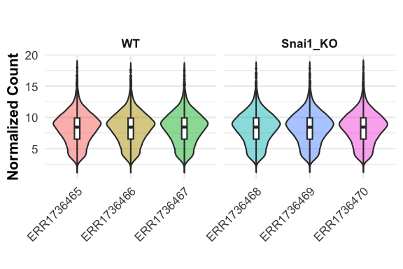

## Sample Euclidean distances with hierarchical clustering

To visualize replicate similarity, Euclidean distances between samples
can be calculated and plotted as a `pheatmap` heatmap using the
`PlotDistances()` function. Darker colors indicate higher similarity,
while lighter colors represent dissimilar samples. This provides a quick
assessment of replicate quality and metadata features that drive
clustering. To save `pheatmap` objects within `RGenEDA`, we can use the
`GenSave()` function, which is similar in function to `ggsave()`.

    hm <- PlotDistances(
        obj,
        meta_cols = c("Genotype"),
        palettes = colorList,
        return = "plot"
    )
    hm$heatmap

    # GenSave(hm, "/path/to/EuclideanDistance_Heatmap.png", width = 6, height = 8)

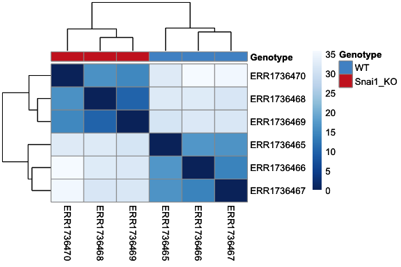

## Identify highly variable genes

Next, genes are ranked by decreasing variance to find highly variable
genes (HVGs) which most-likely drive biological differences. The full
variance profile curve for all genes can be plotted with
`PlotHVGVariance()` as a means to pick a meaningful number of HVGs to
retain for calculating principal components in the next section.

    #----- Plot variance profile
    PlotHVGVariance(obj)

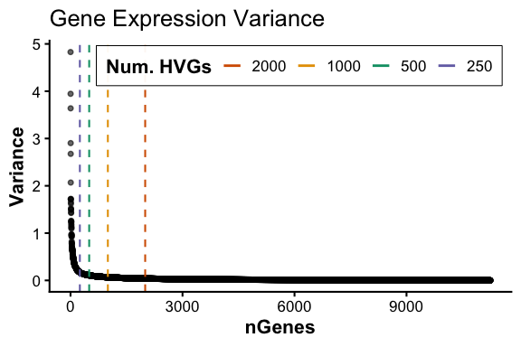
Based on the curve, 2,000 genes seems sufficient in capturing the
majority of variation. These genes can be extracted and retained in the
HVGs slot with `FindVariableFeatures()`

    #----- Add HVGs to object
    obj <- FindVariableFeatures(obj, 2000)

    # == Access HVGs with the accessor function
    head(HVGs(obj))
    #> [1] "THY1"   "CCL2"   "SSX1"   "AKR1C2" "GPX1"   "MYL12B"

## Principal component analysis

Using the identified HVGs, principal components can be calculated using
`RunPCA()` This function stores PCA results in the DimReduction slot,
including:

- `$Scores` (sample scores: one row per sample, one column per PC)

- `$Eigenvectors` (gene loadings, i.e. the rotation matrix: one row per
  gene, one column per PC)

- `$percent_var` (numeric percent of total variance explained by each
  PC)

If `FindVariableFeatures()` was not run beforehand, `RunPCA` will
calculate HVGs by default with 2000 features. This argument can be
overridden directly using the `nfeatures` argument.

    obj <- RunPCA(obj)
    #> Calculating principal components from top 2000 HVGs
    #> Percent variance explained:
    #> PC1: 85.43%
    #> PC2: 7.07%
    #> PC3: 3.89%
    #> PC4: 2.28%
    #> PC5: 1.33%
    #> PC6: 0.00%

    # Inspect PCA outputs with the DimReduction() accessor
    pca <- DimReduction(obj)
    head(pca$Scores)
    #>                  PC1       PC2         PC3         PC4          PC5
    #> ERR1736465 -12.26994  4.841985  1.95261904  2.98311973  0.770544259
    #> ERR1736466 -14.27872 -2.406553 -5.26248029 -0.01697393  0.313289330
    #> ERR1736467 -13.35504 -1.694899  3.44737576 -3.03463682 -1.042987566
    #> ERR1736468  12.70944 -4.145799  1.47958222  0.20911815  2.703775110
    #> ERR1736469  12.51669 -2.370634  0.09842185  2.20330061 -2.739470641
    #> ERR1736470  14.67757  5.775900 -1.71551858 -2.34392774 -0.005150492
    #>                     PC6
    #> ERR1736465 3.993043e-14
    #> ERR1736466 4.093910e-14
    #> ERR1736467 3.968706e-14
    #> ERR1736468 3.303503e-14
    #> ERR1736469 3.173788e-14
    #> ERR1736470 3.630529e-14
    head(pca$Eigenvectors)
    #>                 PC1          PC2           PC3          PC4          PC5
    #> THY1    0.150266440 -0.022809065  0.0000110537 -0.006329718 -0.028030018
    #> CCL2    0.135706807 -0.025658201  0.0070373490  0.003838021 -0.040018651
    #> SSX1   -0.130106138  0.036993763  0.0189472965 -0.007723523  0.001874006
    #> AKR1C2 -0.116614608  0.003828601  0.0030343526 -0.019723927 -0.002551927
    #> GPX1    0.111588141  0.002460421 -0.0335286040 -0.039545468 -0.007872470
    #> MYL12B  0.005002684  0.178455620 -0.2807259755  0.269866847 -0.311091450
    #>                PC6
    #> THY1   -0.13041073
    #> CCL2    0.12077408
    #> SSX1    0.04077754
    #> AKR1C2  0.06171997
    #> GPX1   -0.01918598
    #> MYL12B -0.00531372
    round(head(pca$percent_var), 2)
    #>   PC1   PC2   PC3   PC4   PC5   PC6 
    #> 85.43  7.07  3.89  2.28  1.33  0.00

    # Visualize a scree plot
    PlotScree(obj)

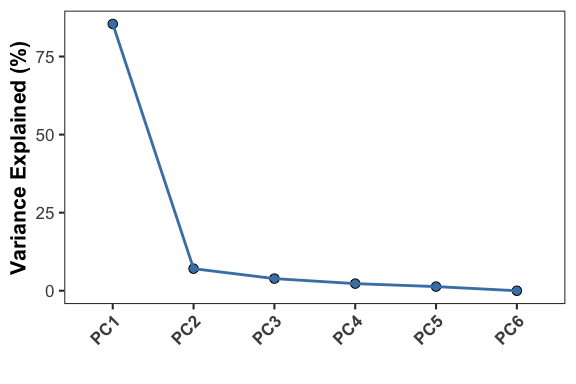

## Extract and visualize PCA results

PCA results merged with metadata can easily be extracted using
`ExtractPCA()` which enables flexible plotting. For convenience,
`PlotPCA()` allows a quick visualization which can also be further
customized with `ggplot2`.

    pcaDF <- ExtractPCA(obj)
    head(pcaDF)
    #>                  PC1       PC2         PC3         PC4          PC5
    #> ERR1736465 -12.26994  4.841985  1.95261904  2.98311973  0.770544259
    #> ERR1736466 -14.27872 -2.406553 -5.26248029 -0.01697393  0.313289330
    #> ERR1736467 -13.35504 -1.694899  3.44737576 -3.03463682 -1.042987566
    #> ERR1736468  12.70944 -4.145799  1.47958222  0.20911815  2.703775110
    #> ERR1736469  12.51669 -2.370634  0.09842185  2.20330061 -2.739470641
    #> ERR1736470  14.67757  5.775900 -1.71551858 -2.34392774 -0.005150492
    #>                     PC6     Sample          Disease Genotype
    #> ERR1736465 3.993043e-14 ERR1736465 breast carcinoma       WT
    #> ERR1736466 4.093910e-14 ERR1736466 breast carcinoma       WT
    #> ERR1736467 3.968706e-14 ERR1736467 breast carcinoma       WT
    #> ERR1736468 3.303503e-14 ERR1736468 breast carcinoma Snai1_KO
    #> ERR1736469 3.173788e-14 ERR1736469 breast carcinoma Snai1_KO
    #> ERR1736470 3.630529e-14 ERR1736470 breast carcinoma Snai1_KO
    #>                   CellLine_CellType
    #> ERR1736465 HS578T - epithelial cell
    #> ERR1736466 HS578T - epithelial cell
    #> ERR1736467 HS578T - epithelial cell
    #> ERR1736468 HS578T - epithelial cell
    #> ERR1736469 HS578T - epithelial cell
    #> ERR1736470 HS578T - epithelial cell

    # Plot PCA
    PlotPCA(
        object = obj,
        x = 1,
        y = 2,
        color_by = "Genotype",
        colors = c("WT" = "steelblue3", "Snai1_KO" = "firebrick3")
    )

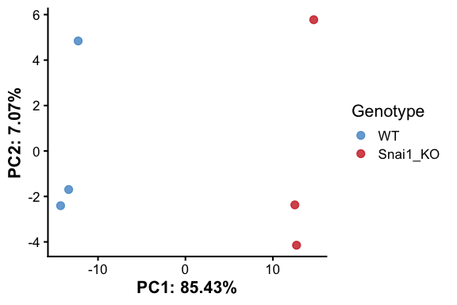

## Explore Eigen vectors of individual PCs

The individual Eigenvectors (genes) that comprise a particular component
of interest can be extracted with `extractEigen()`, which returns each
gene’s loading (`EigenVector`) and its percent contribution to the PC
(`Contribution`). The contribution is the gene’s share of the PC’s
squared loadings,
100 ⋅ *v**i*2/∑*j**v**j*2,
so contributions sum to 100 within a PC. It is not the percent of total
variance explained by the gene. `PlotEigenHeatmap()` shows the Z-scaled
normalized expression of the top genes as a heatmap, with `Contribution`
as a row annotation. This can again identify sample-to-sample
differences.

    pc1_eigen <- extractEigen(
        object = obj,
        component = "PC1"
    )
    head(pc1_eigen)
    #>     Gene  EigenVector Contribution
    #> 1   THY1  0.150266440  2.258000304
    #> 2   CCL2  0.135706807  1.841633753
    #> 3   SSX1 -0.130106138  1.692760703
    #> 4 AKR1C2 -0.116614608  1.359896690
    #> 5   GPX1  0.111588141  1.245191327
    #> 6 MYL12B  0.005002684  0.002502684

    hm2 <- PlotEigenHeatmap(obj,
        pc = "PC1",
        n = 25,
        annotate_by = "Genotype",
        annotate_colors = colorList
    )
    hm2$heatmap

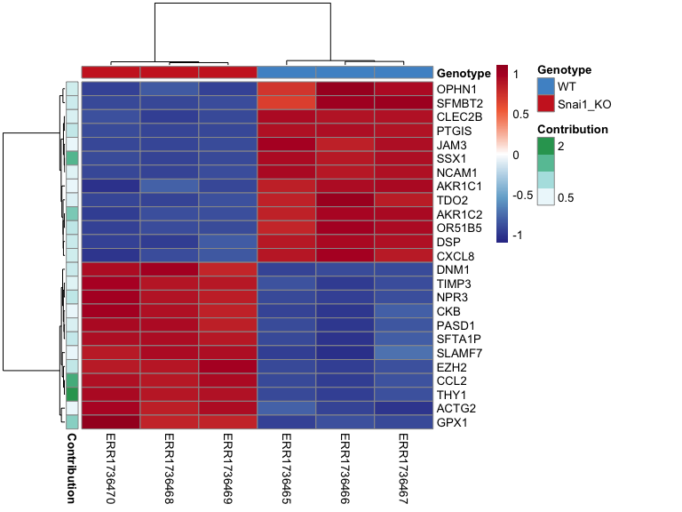

    # GenSave(hm2, "/path/to/EuclideanDistance_Heatmap.png", width = 6, height = 8)

## Correlate PCs with metadata

To interpret principal components, individual PCs can be correlated with
sample metadata using `PlotEigenCorr()`. This function computes Pearson
correlations and displays them as a heatmap, helping to reveal which
metadata features are most associated with major axes of variation.
Categorical variables with two levels (such as Genotype) use Pearson
correlation; categorical variables with more than two levels (such as
batch) are summarized by the unsigned multiple correlation R from a
one-way linear model, so results do not depend on how levels are
labelled. Variables that cannot be tested, such as columns with a single
value or a unique value per sample (here, Disease, CellLine\_CellType,
and Sample), are dropped.

Each PC x covariate cell is a separate test, so the p-values are
adjusted for multiple testing with `p.adjust()` (Benjamini-Hochberg by
default; set with `p_adjust_method`). The stars on the heatmap use the
adjusted p-values. With only 6 samples here, these tests have very
little power, so read the heatmap as exploratory. This function returns
a list of 6 elements:

- `$cor_matrix` (Pearson correlation values, or multiple correlation R
  for variables with more than two levels)

- `$padj_matrix` (adjusted p-values, used for the stars and the plot)

- `$pval_matrix` (unadjusted p-values, for reference)

- `$stars` (asterisk representations of the adjusted p-values)

- `$p_adjust_method` (the correction method used)

- `$plot` (Eigencorr plot, as a `ggplot2` object, which can be saved
  with `ggsave`)

**Note:** `PlotOrdCorr()` works like `PlotEigenCorr()`, but correlates
metadata features with non-metric multidimensional scaling (NMDS) axes
of a sample dissimilarity matrix (Bray-Curtis by default) instead of
PCs. It applies the same multiple-testing correction (`p_adjust_method`)
and returns the same `$padj_matrix`, `$pval_matrix` and `$stars`
elements.

    ec <- PlotEigenCorr(obj, num_pcs = 5)
    ec$plot

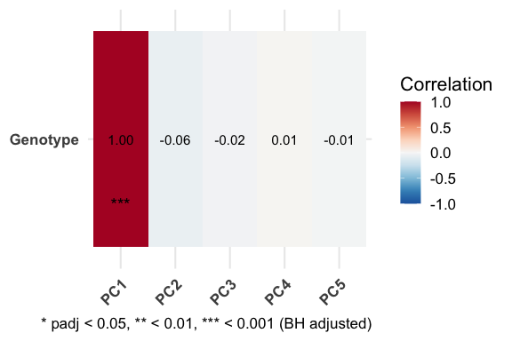

## Explore DEGs

Differentially expressed genes can now be stored in the `RGenEDA`
object. `RGenEDA` was designed to directly work with DEG tables derived
from `DESeq2` and contain the column names “baseMean”, “log2FoldChange”
and “padj”. DEG tables from other packages can be used with some minor
dataframe manipulation.

Note: multiple DEG assays can be appended to the DEGs slot by passing an
assay name in the `SetDEGs()` command (for example, raw DESeq2 results
and Shrunk DESeq2 results.)

To get a quick diagnosis of the differential expression results, a
histogram of un-corrected pvalues can be plotted using `PlotPValHist()`.

    res <- results(dds) |>
        as.data.frame()

    # Set a new DEG assay
    obj <- SetDEGs(
        object = obj,
        deg_table = res,
        assay = "unfiltered"
    )

    # P value histogram
    PlotPValHist(obj,
        assay = "unfiltered",
        alpha = 0.05
    )

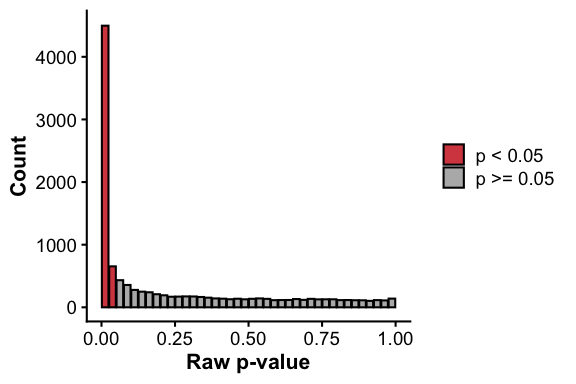

To quickly summarize the DEG results with different thresholds, run
`SummarizeDEGs`(). This function can take multiple assays if needed and
outputs results in a tabular format.

DEG assays can be filtered and directly saved as a new assay in the DEGs
slot using `FilterDEGs()`

    # Summarize DEGs
    SummarizeDEGs(obj,
        alpha = 0.05,
        lfc1 = 1,
        lfc2 = 2
    )
    #>                                 unfiltered
    #> padj<=0.05 & log2FC >=1 (Up)           656
    #> padj<=0.05 & log2FC <=-1 (Down)        542
    #> padj<=0.05 & log2FC >=2 (Up)           228
    #> padj<=0.05 & log2FC <=-2 (Down)        181

    # Filter the DEG assay and save as a new one
    obj <- FilterDEGs(
        object = obj,
        assay = "unfiltered",
        alpha = 0.05,
        l2fc = 1,
        saveAssay = "padj05_lfc1"
    )

    # Grab results with accessor function
    nrow(DEGs(object = obj, assay = "unfiltered"))
    #> [1] 11247
    nrow(DEGs(object = obj, assay = "padj05_lfc1"))
    #> [1] 1198

Basic DEG visualizations plots such as MA plots and volcano plots can be
plotted using `PlotMA()` and `PlotVolcano()` “Num” and “Den” arguments
refer to numerator level and denominator level (reference level of
experiment, in our case, “WT”)

    PlotMA(obj,
        assay = "unfiltered",
        alpha = 0.05,
        l2fc = 1
    )

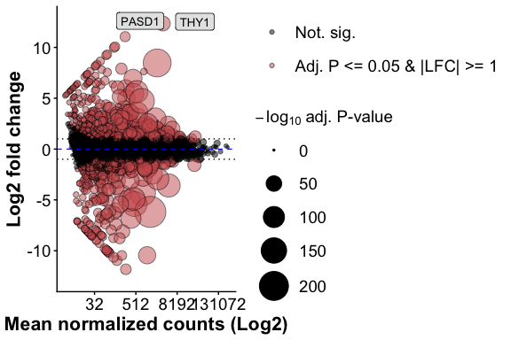

Or a volcano plot by specifying numerator and denominator (denominator
is your comparison reference level).

    PlotVolcano(obj,
        assay = "unfiltered",
        alpha = 0.05,
        l2fc = 1,
        den = "WT",
        num = "Snai1_KO",
        title = "Example Volcano"
    )

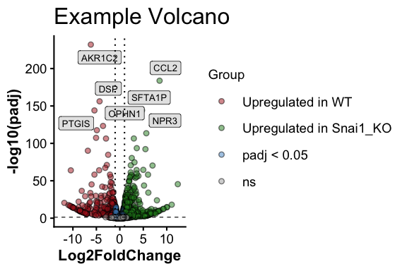

To get a glance at everything at once, we can plot a differential
expression dashboard with `DEDashboard()`
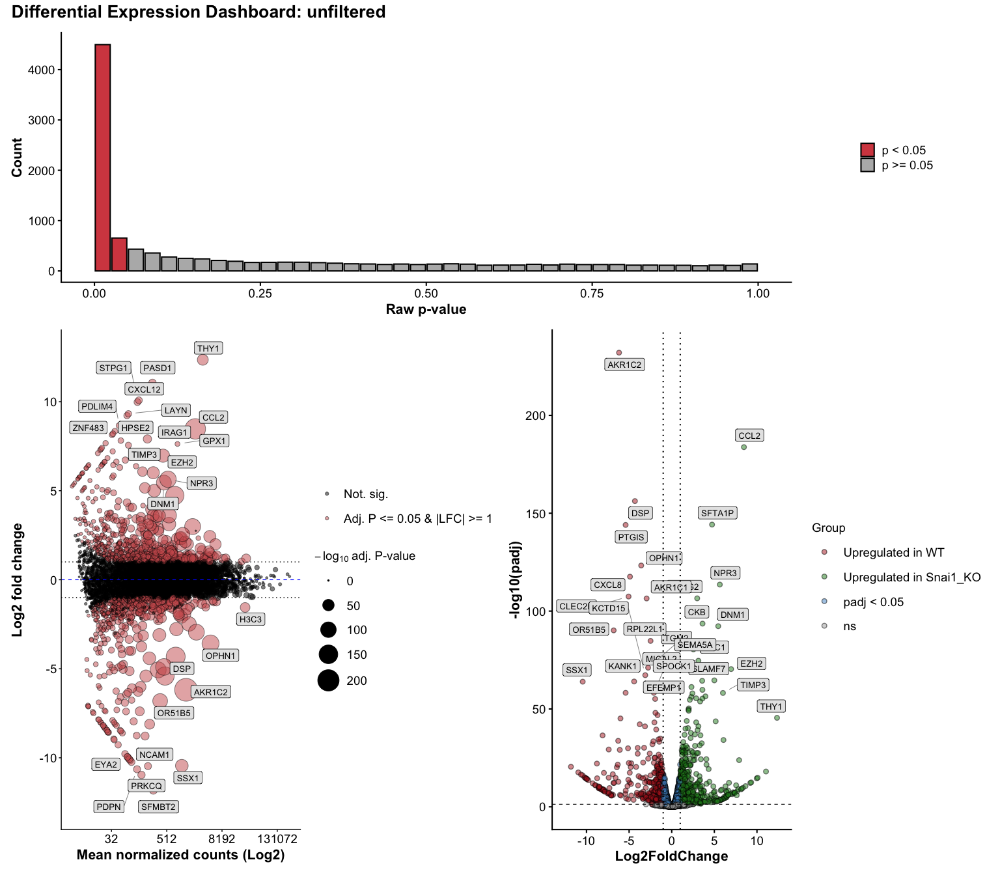

To explore whether a differentially expressed gene (DEG) is also a
highly variable gene (HVG), the intersect of these two vectors can be
taken to obtain highly variable DEGs (hvDEGs), which can be useful for
applications such as gene-set variation analysis (GSVA). To obtain this,
the `FindHVDEGs()` function can be used. The direction of fold change to
intersect with HVGs can be either “positive”, or “negative”, which
returns a vector of genes, or “both” which contains a list with
`$positive`, `$negative`, and `$both` slots.

    FindHVDEGs(obj,
        assay = "padj05_lfc1",
        direction = "negative"
    )
    #> 332 -log2FC hvDEGs found.
    #>   [1] "CAMKK1"       "ACSM3"        "TMEM98"       "DLX6"         "MAP3K9"      
    #>   [6] "PRSS21"       "FUZ"          "CEP68"        "ERCC1"        "BID"         
    #>  [11] "ABCC2"        "DEF6"         "LRRC7"        "VCAN"         "SPATA7"      
    #>  [16] "CAPG"         "MPC1"         "GUCY1B1"      "EYA2"         "ANKRD44"     
    #>  [21] "PRKCQ"        "MTHFD2"       "TRO"          "NAV3"         "MAST4"       
    #>  [26] "GAL"          "CLTCL1"       "DGCR2"        "MGAT4A"       "VASH1"       
    #>  [31] "ST6GAL1"      "ZNF532"       "TUBE1"        "MLH1"         "ARHGEF1"     
    #>  [36] "SLC1A3"       "OPHN1"        "CARMIL1"      "IGSF9B"       "CXCL2"       
    #>  [41] "MMP2"         "TESC"         "DLL3"         "DSP"          "SYDE2"       
    #>  [46] "PCSK5"        "TRMT2A"       "SMARCB1"      "PPM1F"        "SRRD"        
    #>  [51] "SEPTIN3"      "SYNGR1"       "PCK2"         "BMP7"         "ISM1"        
    #>  [56] "TRIB3"        "FERMT1"       "ZNF516"       "KLHL4"        "CPPED1"      
    #>  [61] "FZD3"         "JPH1"         "GDAP1"        "TUBB4A"       "FCGRT"       
    #>  [66] "NOVA2"        "OLFM2"        "TIMM50"       "DMAC2"        "CARD8"       
    #>  [71] "TMEM59L"      "SCN1B"        "CADM4"        "PTN"          "GIMAP2"      
    #>  [76] "TRIM14"       "KANK1"        "COL1A1"       "CLEC2B"       "PARP11"      
    #>  [81] "VDR"          "ADGRD1"       "PHC1"         "SOBP"         "PHACTR2"     
    #>  [86] "SEMA5A"       "GHR"          "PCDHB5"       "PCDHB6"       "CDH6"        
    #>  [91] "SLC12A7"      "EHHADH"       "PODXL2"       "ARHGEF26"     "EFEMP1"      
    #>  [96] "IL18R1"       "ID2"          "NOL10"        "SLC25A12"     "SDC1"        
    #> [101] "ORC4"         "PAPPA2"       "RHOU"         "CTH"          "AGMAT"       
    #> [106] "ADGRL2"       "IFT46"        "MREG"         "UBE3D"        "TGIF2"       
    #> [111] "ABCG2"        "LGALSL"       "BCL11A"       "PCDHB12"      "RDH10"       
    #> [116] "PDZRN3"       "KIAA1549"     "BAZ2B"        "PFKFB2"       "DAW1"        
    #> [121] "PTGIS"        "SNAI1"        "ZNF576"       "BMP4"         "EML2"        
    #> [126] "TMX4"         "ID1"          "SSX1"         "GNAZ"         "PODXL"       
    #> [131] "CHAC1"        "KIF1A"        "AFDN"         "ZNF227"       "THOC6"       
    #> [136] "PER2"         "TTC9"         "PSAT1"        "MSI1"         "ACVR1B"      
    #> [141] "OS9"          "MAP7"         "NHSL1"        "NIBAN1"       "EDNRB"       
    #> [146] "GATA4"        "CTSV"         "KIAA0319"     "FLOT1"        "SULF1"       
    #> [151] "FXYD6"        "GPAT3"        "BMPR1B"       "LEF1"         "CLSTN3"      
    #> [156] "INHBE"        "RAB15"        "STON2"        "NUDT7"        "CDH13"       
    #> [161] "GAREM1"       "TTYH2"        "IGFBP4"       "GEMIN7"       "WTIP"        
    #> [166] "CRABP2"       "ETNK2"        "ALDH1L1"      "OTULINL"      "TNFAIP8"     
    #> [171] "FAXC"         "SDK1"         "ZNF214"       "NCAM1"        "FEZ1"        
    #> [176] "MPP7"         "CDH8"         "IL18"         "AKR1C2"       "TDO2"        
    #> [181] "SPOCK1"       "PRDM8"        "BMP6"         "PTPRD"        "KCTD15"      
    #> [186] "ANKFN1"       "KIF5A"        "TSPAN7"       "CD109"        "MMP14"       
    #> [191] "ARSL"         "TMSB15A"      "TSPAN33"      "ZNF208"       "FAM171A2"    
    #> [196] "PDPN"         "CADM3"        "EIF4E3"       "RPL22L1"      "HHIP"        
    #> [201] "TBX20"        "STEAP1"       "ELAPOR2"      "ZNF704"       "CHMP4C"      
    #> [206] "ADCY1"        "SLC16A9"      "PKNOX2"       "JCAD"         "JAM3"        
    #> [211] "STXBP4"       "PPFIBP2"      "CYB5R2"       "PRTG"         "RIMKLB"      
    #> [216] "NNMT"         "GPRC5B"       "OR51B5"       "OR51I1"       "CYP2S1"      
    #> [221] "NXN"          "DDIT4"        "COA6"         "ZNF30"        "STXBP6"      
    #> [226] "CXCL8"        "ZFPM2"        "SMAD1"        "KRT8"         "HOXB9"       
    #> [231] "CHD7"         "LURAP1"       "DLK2"         "LRRC34"       "CYP4F11"     
    #> [236] "TLN2"         "ZNF556"       "CALB2"        "SLCO2A1"      "BRSK2"       
    #> [241] "NUPR1"        "OR51B6"       "EID2"         "EID2B"        "SYNE3"       
    #> [246] "NCKAP5"       "MAGEF1"       "SOX12"        "HNRNPA0"      "AP3S1"       
    #> [251] "ZNF223"       "ARL14"        "NLRP11"       "F2R"          "ZNF322"      
    #> [256] "OR52D1"       "FDX1P1"       "PLCB1"        "CADM1"        "OR51B4"      
    #> [261] "TMEM121B"     "SCN5A"        "THAP7"        "OR51M1"       "SLC24A3"     
    #> [266] "MRPL40"       "PRAME"        "KCNQ5"        "KRT10"        "ZNF397"      
    #> [271] "AKR1C1"       "ZKSCAN4"      "ZNF70"        "PABIR1"       "OR51I2"      
    #> [276] "FAM78B"       "ZFP92"        "AKR1C3"       "PPP1R26"      "POTEF"       
    #> [281] "TCF4"         "ZNF512B"      "MVB12B"       "ZSCAN26"      "STMN3"       
    #> [286] "COL13A1"      "TUBA3C"       "MDM4"         "FAM169A"      "ZNF830"      
    #> [291] "SCAMP5"       "ZNF521"       "SFMBT2"       "DZIP3"        "OR2L2"       
    #> [296] "GPANK1"       "MRPS18B"      "PRR3"         "TMEM200C"     "GPSM3"       
    #> [301] "EMP2"         "RTL10"        "RABGAP1L-IT1" "RFPL4A"       "SNHG14"      
    #> [306] "APCDD1L-DT"   "YWHAEP1"      "RNASEH1-AS1"  "ZSCAN31"      "FOXD2-AS1"   
    #> [311] "POU5F1P4"     "PRKCQ-AS1"    "GUSBP2"       "PEG10"        "N4BP2L2"     
    #> [316] "LINC00504"    "RBBP4P1"      "CHCHD10"      "PCDHB17P"     "PECAM1"      
    #> [321] "GNAO1-AS1"    "SH3GL1P1"     "LIN37"        "NCBP2AS2"     "CAHM"        
    #> [326] "ZNF595"       "FAM106A"      "H2BC3"        "H2AC16"       "H4C1"        
    #> [331] "OR51B2"       "H3C3"

## Moving results back to a SummarizedExperiment

Use `as(obj, "SummarizedExperiment")` to move a `geneda` object, with
its HVGs, PCA and DEG tables, into a `SummarizedExperiment` for other
Bioconductor tools. `as.geneda()` reads the same layout back, so no
information is lost.

    se <- as(obj, "SummarizedExperiment")
    se
    #> class: SummarizedExperiment 
    #> dim: 11247 6 
    #> metadata(1): RGenEDA
    #> assays(1): normalized
    #> rownames(11247): TSPAN6 DPM1 ... PRRC2B F8A1
    #> rowData names(2): isHVG hvgRank
    #> colnames(6): ERR1736465 ERR1736466 ... ERR1736469 ERR1736470
    #> colData names(4): Sample Disease Genotype CellLine_CellType

    # HVGs are flagged in rowData; PCA and DEG tables are in metadata()
    table(SummarizedExperiment::rowData(se)$isHVG)
    #> 
    #> FALSE  TRUE 
    #>  9247  2000
    names(S4Vectors::metadata(se)$RGenEDA$DEGs)
    #> [1] "unfiltered"  "padj05_lfc1"

    # Round trip back to a geneda object
    identical(as.geneda(se), obj)
    #> [1] TRUE

# Session information

    sessionInfo()
    #> R version 4.4.1 (2024-06-14)
    #> Platform: aarch64-apple-darwin20
    #> Running under: macOS Sonoma 14.6
    #> 
    #> Matrix products: default
    #> BLAS:   /Library/Frameworks/R.framework/Versions/4.4-arm64/Resources/lib/libRblas.0.dylib 
    #> LAPACK: /Library/Frameworks/R.framework/Versions/4.4-arm64/Resources/lib/libRlapack.dylib;  LAPACK version 3.12.0
    #> 
    #> locale:
    #> [1] C
    #> 
    #> time zone: America/New_York
    #> tzcode source: internal
    #> 
    #> attached base packages:
    #> [1] stats4    stats     graphics  grDevices utils     datasets  methods  
    #> [8] base     
    #> 
    #> other attached packages:
    #>  [1] ggtext_0.1.2                lubridate_1.9.4            
    #>  [3] forcats_1.0.0               stringr_1.6.0              
    #>  [5] dplyr_1.2.0                 purrr_1.2.1                
    #>  [7] readr_2.1.5                 tidyr_1.3.2                
    #>  [9] tibble_3.3.1                ggplot2_4.0.2              
    #> [11] tidyverse_2.0.0             pasilla_1.32.0             
    #> [13] DEXSeq_1.50.0               RColorBrewer_1.1-3         
    #> [15] AnnotationDbi_1.68.0        DESeq2_1.44.0              
    #> [17] SummarizedExperiment_1.36.0 GenomicRanges_1.58.0       
    #> [19] GenomeInfoDb_1.42.3         IRanges_2.40.1             
    #> [21] S4Vectors_0.44.0            MatrixGenerics_1.18.1      
    #> [23] matrixStats_1.5.0           Biobase_2.66.0             
    #> [25] BiocGenerics_0.52.0         BiocParallel_1.40.2        
    #> [27] RGenEDA_0.99.1             
    #> 
    #> loaded via a namespace (and not attached):
    #>  [1] DBI_1.2.3               bitops_1.0-9            httr2_1.2.1            
    #>  [4] biomaRt_2.60.1          rlang_1.1.7             magrittr_2.0.4         
    #>  [7] compiler_4.4.1          RSQLite_2.4.2           png_0.1-8              
    #> [10] vctrs_0.7.2             pkgconfig_2.0.3         crayon_1.5.3           
    #> [13] fastmap_1.2.0           dbplyr_2.5.1            XVector_0.46.0         
    #> [16] labeling_0.4.3          Rsamtools_2.22.0        rmarkdown_2.29         
    #> [19] tzdb_0.5.0              UCSC.utils_1.2.0        bit_4.6.0              
    #> [22] xfun_0.53               zlibbioc_1.52.0         cachem_1.1.0           
    #> [25] jsonlite_2.0.0          progress_1.2.3          blob_1.2.4             
    #> [28] DelayedArray_0.32.0     parallel_4.4.1          prettyunits_1.2.0      
    #> [31] R6_2.6.1                stringi_1.8.7           genefilter_1.86.0      
    #> [34] Rcpp_1.1.1              knitr_1.50              timechange_0.3.0       
    #> [37] Matrix_1.7-3            splines_4.4.1           tidyselect_1.2.1       
    #> [40] dichromat_2.0-0.1       abind_1.4-8             yaml_2.3.10            
    #> [43] codetools_0.2-20        hwriter_1.3.2.1         curl_7.0.0             
    #> [46] lattice_0.22-7          withr_3.0.2             KEGGREST_1.44.1        
    #> [49] S7_0.2.1                evaluate_1.0.5          survival_3.8-3         
    #> [52] BiocFileCache_2.12.0    xml2_1.4.0              Biostrings_2.74.1      
    #> [55] pillar_1.11.1           filelock_1.0.3          generics_0.1.4         
    #> [58] hms_1.1.3               scales_1.4.0            xtable_1.8-4           
    #> [61] glue_1.8.0              pheatmap_1.0.13         tools_4.4.1            
    #> [64] annotate_1.82.0         locfit_1.5-9.12         XML_3.99-0.19          
    #> [67] grid_4.4.1              colorspace_2.1-2        GenomeInfoDbData_1.2.13
    #> [70] patchwork_1.3.2         cli_3.6.5               rappdirs_0.3.3         
    #> [73] S4Arrays_1.6.0          gtable_0.3.6            digest_0.6.37          
    #> [76] SparseArray_1.6.2       ggrepel_0.9.8           geneplotter_1.82.0     
    #> [79] farver_2.1.2            memoise_2.0.1           htmltools_0.5.8.1      
    #> [82] lifecycle_1.0.5         httr_1.4.7              statmod_1.5.0          
    #> [85] gridtext_0.1.5          bit64_4.6.0-1
